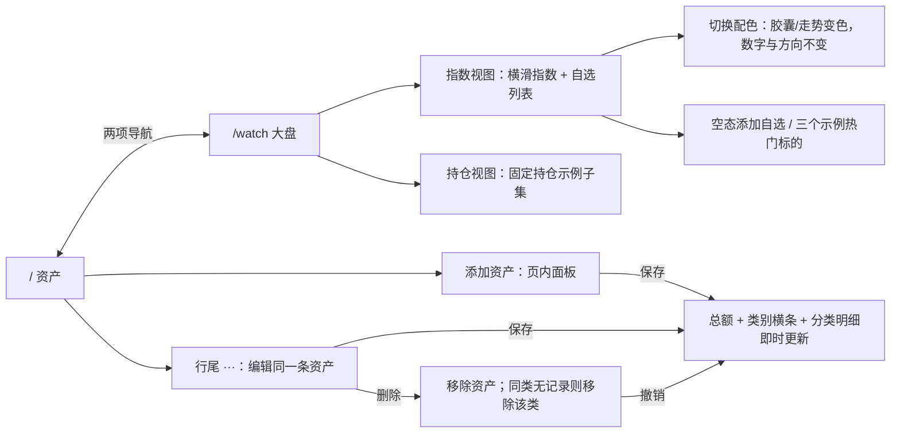

# L1 两页设计契约：资产与大盘

当前依据：OPHE-30 最新两页评论、iOS 参照规格及新版父任务 OPHE-29。产品只交付 / 资产与 /watch 大盘；记账、流水、预算、月报、测算界面均不在本轮范围。此前三方向不重做，沿用 A 的视觉基底。

浏览器直接打开 `review.html` 评审，或从 `index.html` 体验。HTML 为可交互设计原型，全部在 `design/l1/`；没有生产业务代码、真实行情或技术选型。

## 信息架构与核心路径

| 路由 | HTML 映射 | 核心任务 | 入口 |
| --- | --- | --- | --- |
| / | index.html | 看总额、配置与分类明细；资产增删改 | 默认入口、两项导航的「资产」 |
| /watch | watch.html | 看指数、自选与持仓示例；切换涨跌色 | 两项导航的「大盘」 |
| 交付评审 | review.html | 两页总览、两套配色、状态与规范 | 仅评审入口，不是第三个产品路由 |

两页导航同名、同序。切页不改另一页数据。资产明细是手动记录，大盘是独立静态行情示例，两者没有隐式买卖、自动估值或账户绑定。

## 资产页

### 阅读顺序

1. 总资产标签与唯一一级数字：桌面 44px，手机 36px；金额单位小字号跟随。其余金额、百分比均降级为 12–16px，不出现第二个同等大小数字。
2. 下面一行「较上次变动 — / 暂无可比行情」。本轮无可比行情，不伪造日收益。
3. 配置结构按类别横条显示，每类同时给出金额和占比。无饼图；每个比例以总资产为分母，所有轨道使用同一尺度。
4. 明细按现金、存款、货币基金、股票、基金、债券、其他的固定顺序分组。无记录的类别不显示。
5. 普通资产行显示名称、金额；股票/基金在同一行结构内补充数量与现价，不用空白占位行。金额右对齐，行尾保留克制的 44px 编辑入口。
6. 桌面配置在左、明细在右；375 宽配置在上、明细在下，可纵向滚动。横条和明细保留相同的类别顺序。

### 增删改与校验

- 「添加资产」直接打开当前页面板，焦点在名称。桌面居中，手机底部展开；不跳路由。
- 必填：名称、类别、金额。名称最多 60 字；金额≥0、最多两位小数，演示上限 1 万亿元。用整数分求和，不把字符串拼接成总额。
- 股票/基金可展开「补充数量与现价」；数量大于 0，现价可为 0，最多四位小数；两项均可不填。资产金额以填写金额为准，补充信息不覆盖金额。
- 保存：总额、类别金额、占比和行数据同时更新，关闭面板并返回对应编辑入口；新增后返回添加入口。提示「本机已保存」。
- 行尾编辑复用相同面板，带入现值。删除入口只在编辑面板内出现，删除后在可见的浮层提示中提供「撤销」，防止误删无处返回；提示可关闭，手机位置在底部导航上方。
- 删除某类唯一一条资产时，该类从配置和明细中一起消失，其他类别占比重算。撤销恢复同一条记录。
- 0 金额资产可留在明细；配置仅展示正金额类别。总额为 0 时不计算比例，显示配置引导，避免 NaN 或虚假的 100%。
- Esc / 取消不保存，焦点回触发处。错误留在面板内并把焦点定位具体字段，保留其余内容。

| 状态 | 文字 / 行为 | 恢复 |
| --- | --- | --- |
| 无资产 | 总额 0.00；「还没有资产记录」「添加第一条资产」 | 直接进入面板 |
| 无正金额配置 | 「记录资产后，这里显示各类金额与占比」 | 添加或更新金额 |
| 名称空白 | 「请填写资产名称」 | 名称获得焦点 |
| 金额不合法 | 明确金额范围和小数位 | 金额获得焦点 |
| 数量 / 现价不合法 | 就地提示并展开补充区 | 对应字段获得焦点 |
| 本机保存失败 | 保留当前显示，提示先保留本页 | 不承诺刷新可保留 |
| 记录格式异常 | 说明先显示示例 | 不伪装为用户已有资产 |
| 删除后 | 指明删除了哪条，提供撤销 | 单次撤销最近删除 |

### 示例核对

初始总额 1,000,000.00 元。现金 40,000（4%）、存款 260,000（26%）、货币基金 150,000（15%）、股票 250,000（25%）、基金 200,000（20%）、债券 100,000（10%）。其他类无记录，不占位显示 0。股票分两行，兼容带数量/现价的样式。

## 大盘页

### 按参照拆解落实

| 来源 | 采用 | 不延伸 |
| --- | --- | --- |
| Apple Stocks | 名称 / 次要全称与代码 / 中间走势 / 右侧价格与实底白字涨跌胶囊 | 不做新闻、K线、交易入口 |
| 同花顺 | 三张指数横排，手机露出第三张约一半；可横滑 | 不做多市场 chips、资讯、直播或功能宫格 |
| 雪球 | 默认红涨绿跌、稳定图标文字导航、资产唯一主数字 | 不做开户、推广或理财推荐 |

参照已从本 issue 的三个附件读取。只借鉴信息结构与触达节奏，不复制原生 iOS 系统控件外观，也不把官方截图作为产品素材。

- 顶部仅「指数 / 持仓」两段。指数视图显示指数带与自选列表；持仓视图显示固定持仓示例子集，不创建第三路由或持仓管理系统。
- 沪深300、标普500、纳指100 为静态示例点位，统一两位小数、千分位，明说非实时。指数卡内数字 17–22px，低于资产主数字。
- 自选行高 64px；名称主、全称/代码次、走势居中、价格与胶囊右对齐。胶囊固定横向内边距和最小宽度，按列对齐。
- sparkline 高 28px，无轴、无网格、无时间标签，只保留形状，色彩跟涨跌；可访问文字标明上涨/下跌/平盘。
- 添加自选在页内选择虚构示例标的。空态居中「还没有关注任何标的」+「添加自选」+ 三个示例热门标的建议。选择后进入自选列表；不发搜索或行情请求。
- 平盘用中性胶囊。涨跌有正负号，页面常驻当前配色与误读提示；不单独依赖颜色。
- 虚构代码 SIM001–SIM005，最新价仅为演示金额，不是真实报价。行情页不把这些数据写回资产估值。

### 涨跌色两版

| 版本 | 胶囊与走势 | 误读风险 |
| --- | --- | --- |
| 默认红涨绿跌 | 上涨红底白字 / 下跌绿底白字 | 美股习惯可能把红读成跌 |
| 绿涨红跌 | 上涨绿底白字 / 下跌红底白字 | A 股习惯可能把绿读成跌 |

切换仅改变语义色，价格、数值、顺序和走势方向保持不变。本机记住选择，刷新后保持。深色模式中走势使用更明亮的语义色；胶囊仍用可承载白字的实底色，保证文字对比度。

## 两页导航建议

推荐：375 底部两 tab，1440 顶部两 tab，均按「资产 / 大盘」排序；底部保留 safe-area 与正文留白，不遮住最后一条内容。600px 为布局断点，601px 起使用顶部导航。

若主要面向电脑，也可两宽度统一顶部 tab，实现差异较少，但手机单手触达较远、占用首屏。当前稿采用推荐组合供评审，不重开三种视觉方向。

## 每页组件清单

| 页面 | 组件 |
| --- | --- |
| 两页共享 | 品牌栏、静态示例标识、两项导航 / 当前页态、状态播报、免责声明 |
| 资产 | 总额 / 单位 / 变动占位、配置类别 / 金额 / 比例 / 横条、分类明细组、普通行 / 数量现价行、行尾编辑、添加按钮、空态 |
| 资产面板 | 添加 / 编辑标题、名称 / 类别 / 金额、可选数量现价折叠区、就地错误、取消 / 保存 / 删除、撤销状态 |
| 大盘 | 标题 / 非实时标识、指数持仓分段、配色 select、横滑指数带、自选标题 / 添加入口、自选行、无轴走势、涨跌胶囊、空态 / 三个建议、添加面板 |
| 评审材料 | 两页入口图、两页缩略图、配色对照、状态链接、规范与验证入口 |

## Tokens 与选择理由（8 行）

1. 保留 A 的色板、系统中文字体、字号阶梯、间距、圆角、无阴影与缓动作为基底。
2. 仅新增总资产 44/36px 层级，满足唯一主数字；其他金融数字用等宽数字。
3. 类别横条与金额、占比并排，便于分辨几个百分点的差异。
4. 普通资产行居中，带数量/现价时自然成为两行，无强制空白第二行。
5. 行尾编辑和页内面板缩短操作路径；删除提供撤销。
6. 实底白字胶囊把涨跌变成易扫读的色块，同时保留正负号。
7. 手机露出半张指数卡提示横滑，使用浏览器原生滚动，支持键盘和触摸。
8. 反馈沿用 120/180ms，并补 200ms 表面反馈；减少动效时变为 0ms，无强制入场动画。

完整 token 在 tokens.css：颜色、12/13/14/16/22/24/44 字号、4/8/12/16/24/32/48 间距、输入/面板/轨道/胶囊圆角、无阴影、时长与缓动、明暗语义色。手机主数字 36px 在 app.css 断点中覆盖。

## 可访问性与交付边界

文本对比度 ≥4.5:1；44px 行尾操作；真实 label 与字段错误关联；aria-current 表示当前页，aria-pressed 表示分段状态；图形有文字替代。原生 dialog 限制背景交互，并显式循环首尾焦点；Esc 关闭后回到操作位置。原生横向滚动区可聚焦用方向键操作，减少动效时不强制平滑滚动。

375/1440 均禁止页面横向滚动；指数带内部横滑是明确设计。长明细、展开面板允许纵向滚动。暗色跟随系统，布局无渐变、营销 hero、卡片套装、资讯或推荐投资话术。

原型写入独立 design namespace，不读写生产数据。裸页面入口继续本机记录；?state=filled/empty/add/edit 等入口用于固定评审初始状态。生产持久化、路由、计算精度与技术栈由 Dev 实现。本次不触碰 src/kernel 或任何生产模块。
